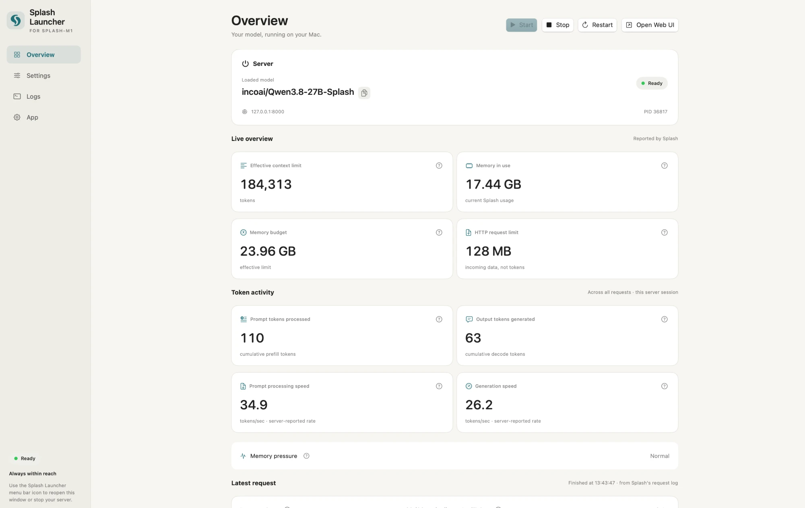
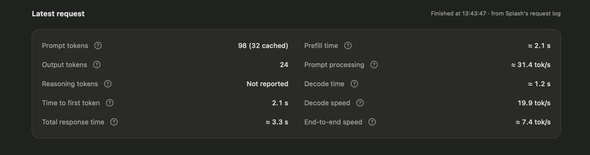
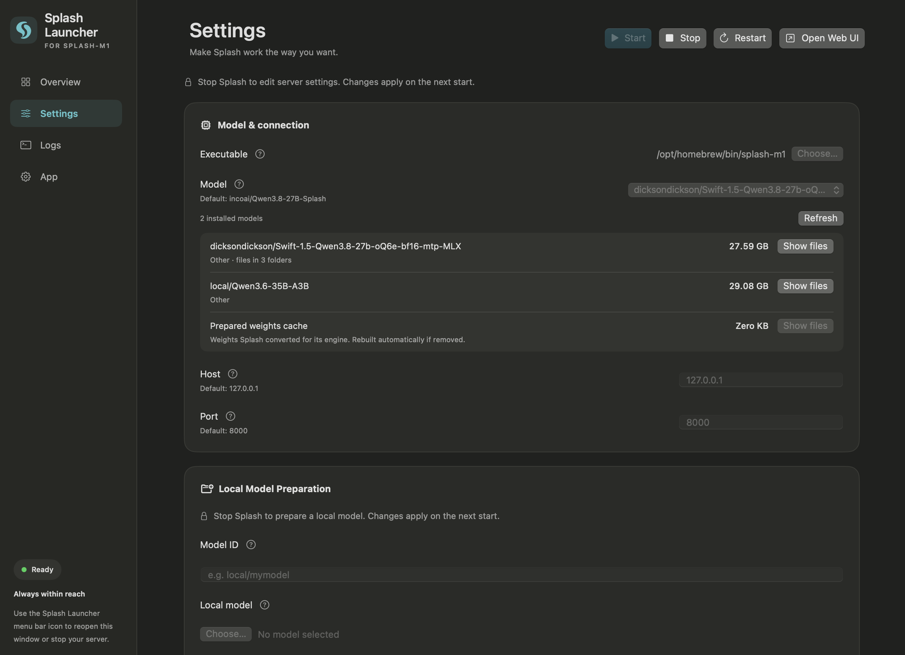
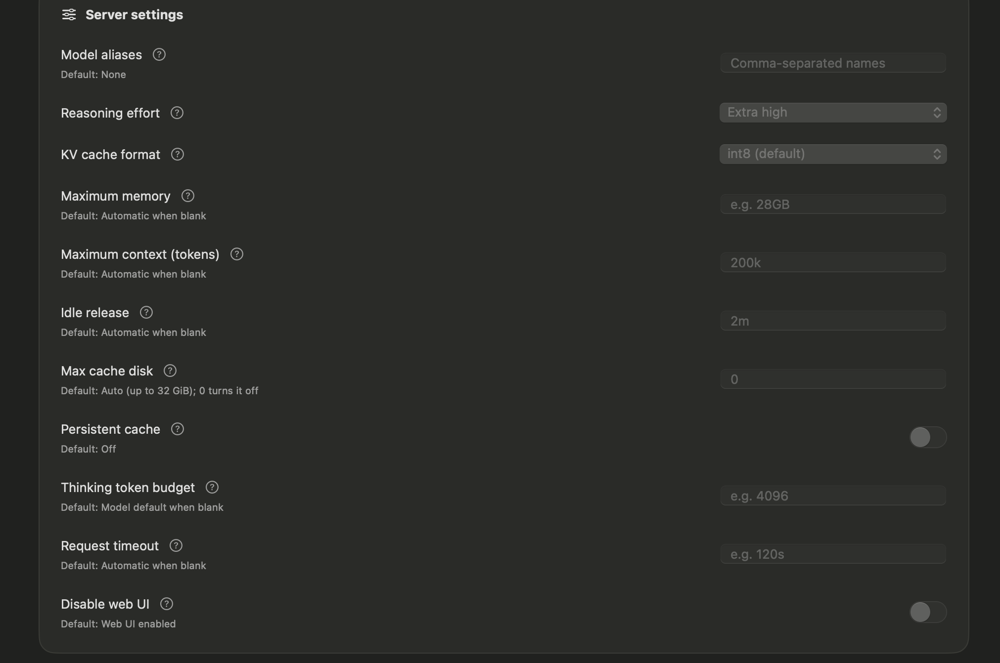
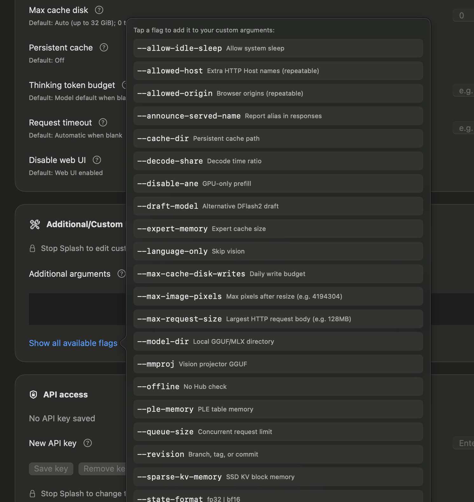
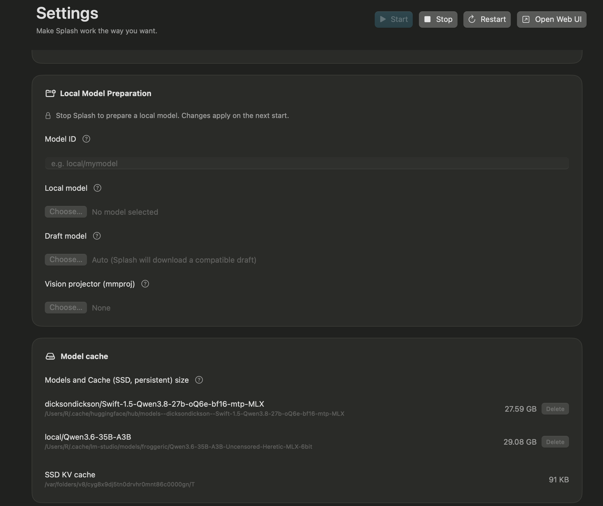

# Splash Launcher

[](https://github.com/Rdx-ai-art/splashM1-launcher/actions/workflows/tests.yml)

A native macOS app for starting, stopping and monitoring a local Splash model server,
without the command line. Built and tested for **Splash-M1**, the community port of
Inco's Splash for M1 and M2 Macs.

> **Unofficial.** Splash Launcher is an independent project. It is not made by,
> affiliated with, or endorsed by the developers of Splash. It controls an existing
> Splash installation and never installs, updates or modifies Splash itself.

<picture>
  <source media="(prefers-color-scheme: dark)" srcset="screenshots_v1.1.0/overview-dark.png">
  
</picture>

## Install

1. **Install Splash-M1** by following the instructions at
   [paperniuk/splash](https://github.com/paperniuk/splash). Splash Launcher controls an
   existing installation and doesn't install Splash for you; if it can't find `splash-m1`, it
   says so and links to that page.
2. **Get Splash Launcher**, either way:
   - **Download** the zip from the
     [latest release](https://github.com/Rdx-ai-art/splashM1-launcher/releases/latest), unzip
     it and move **Splash Launcher** to Applications. The app isn't notarised by Apple, so the
     first time you open it macOS blocks it: open **System Settings → Privacy & Security** and
     click **Open Anyway**. Each release is built by GitHub Actions from that version's source.
   - **Or build it from source** with Xcode 15.3 or later, or the Command Line Tools
     (`xcode-select --install`):

     ```bash
     git clone https://github.com/Rdx-ai-art/splashM1-launcher.git
     cd splashM1-launcher
     zsh Scripts/build-app.zsh
     open "dist/Splash Launcher.app"
     ```

     To update, run `git pull` and `zsh Scripts/build-app.zsh` again.

## How it fits together

- **Splash** is Inco AI's local inference engine for M3 and newer Macs.
- **Splash-M1** is a community port of Splash for M1 and M2 Macs. You install it separately.
- **Splash Launcher** (this app) starts, stops and monitors Splash-M1. It doesn't run models
  itself, and your chat apps talk to the Splash-M1 server directly, not through the launcher.

## Features

- **Start, stop and restart** Splash with one click, and open its web chat page.
- **Server version** displayed on the Overview page.
- **Port conflict detection:** gracefully reports when the port is already in use (e.g. a
  terminal `splash-m1` instance) without requiring termination.
- **Settings:**
  - **Model & Connection:** model, host, port, reasoning effort, KV cache format, memory and
    context limits, model aliases, and an optional API key stored in the macOS Keychain.
  - **Server performance:** idle release (`--idle-release`), max cache disk
    (`--max-cache-disk`), persistent cache (`--persistent-cache`), thinking token budget
    (`--thinking-token-budget`), request timeout (`--request-timeout`).
  - **Additional/Custom Flags:** free-form CLI arguments passed directly to Splash. A
    "Show all available flags" popover lists unmanaged options alphabetically for reference.
- **Local Model Preparation:**
  - Choose a local GGUF/MLX model folder or file, optional draft model, and optional
    vision projector (mmproj).
  - Displays chosen model name and size.
  - Draft model: leave blank for Splash to auto-download a compatible draft.
  - mmproj: only needed for GGUF models, not passed for MLX.
  - Prepared models appear in the Model & Connection picker.
- **Live overview:**
  - Readiness, memory use and limits, and context limit, as reported by Splash.
  - Token activity for the whole server session.
  - A **Latest request** panel with prompt, cached and output tokens, time to first
    token, decode speed, and derived prefill, decode and total times.
- **Models and Cache (SSD, persistent) size:**
  - Installed models with their real on-disk sizes (resolves symlinks to source files).
  - Per-model **Delete** button with confirmation dialog (removes source files).
  - **SSD KV cache** size and location (temp, visible while Splash is running).
  - **Persistent KV cache** size and location (`~/Library/Caches/Splash/prefix-cache/`).
- **Server output** log that fits the window, with auto-scroll (anchored left), Copy,
  download progress bars that update in place, and any API key redacted.
- **Menu bar** control to reopen the window or stop the server.
- **Optional extras:** launch at login, and a light, dark or system appearance.
- **Settings persist** across app restarts (stored in macOS UserDefaults).











## Requirements

- macOS 14 or later on an M1 or M2 Mac.
- An existing Splash-M1 installation ([paperniuk/splash](https://github.com/paperniuk/splash)).
  The launcher looks for `splash-m1` in
  `/opt/homebrew/bin` and `~/.local/bin`, or you can choose the executable in Settings.
- Official Splash (M3 or newer) uses the same API and may work if you choose its `splash`
  executable in Settings, but it hasn't been tested.
- To build: Xcode 15.3+ or a Swift 5.10+ toolchain.

## Development

`Scripts/build-app.zsh` builds a release binary and packages it as
`dist/Splash Launcher.app`, ad-hoc signed for local use. `swift build` and `swift test`
compile and test the code but don't update the app bundle. Running the tests needs full
Xcode, because the Command Line Tools don't include XCTest.

```bash
swift test
```

To publish a release, push a version tag such as `v1.1.0`. The
[Release workflow](.github/workflows/release.yml) then runs the tests, builds the app with
that version number, and attaches the zip and its SHA-256 checksum to a GitHub Release.

## How it behaves

- **Local by default:** binds to `127.0.0.1` on port `8000`, so only this Mac can
  connect. Change the host deliberately if you want other devices to reach it.
- **Only stops what it started:** the launcher stops a Splash process only if it
  launched that process itself. A server started elsewhere is never stopped.
- **Port conflicts:** if the configured port is already in use (e.g. a terminal
  `splash-m1` instance), the launcher reports the conflict without killing the
  existing process.
- **No shell:** Splash is launched directly with an explicit argument list, never
  through a shell.
- **Keys stay hidden:** the API key is kept in the Keychain, passed to Splash through
  its environment, and redacted from the log view.
- **Latest request panel:** this reads the summary line Splash prints after each
  request. It only works for servers this app started. Values marked "≈" are calculated
  from that line, not measured directly.
- **Local model dedup:** the launcher scans Splash's `.selections` and `.resolved`
  directories for installed models. Path-based local models are only created when the
  stored value is a filesystem path, preventing stale duplicates.

## Acknowledgements

Splash Launcher builds on [Splash](https://github.com/incoai/splash) by Inco AI and the
community [Splash-M1 port](https://github.com/paperniuk/splash) for M1 and M2 Macs. Both are
independent projects; Splash Launcher is not affiliated with either.

## Credits

The app icon concept (an upright "S-Wave") was developed with design assistance from ChatGPT.
The mark is drawn in code from a single source,
[`SplashMark.swift`](Sources/SplashLauncher/SplashMark.swift), which produces the app icon,
the sidebar mark and the menu bar symbol.

## License

[MIT](LICENSE)
